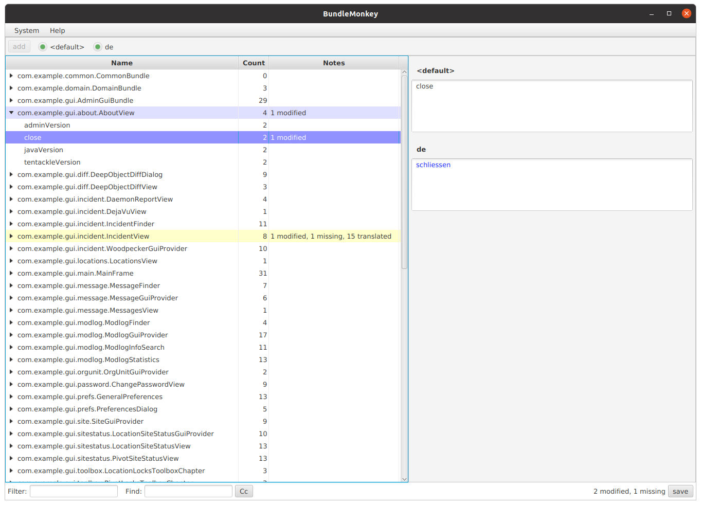

# BundleMonkey

**BundleMonkey** is GUI tool to edit the resource bundles of a Tentackle application.
The application automatically retrieves the bundles from the database instead of the application's jars,
if the tentackle-i18n module is part of the module- or classpath. Whenever the application finds
the corresponding bundle in the database, the database version will be used. If there is no such database
bundle, the application's resource bundle is used.

## Workflow

### Push
In order to use the database-backed bundles (a.k.a *stored bundles*), the application's
resource bundles must be pushed to the database with the maven 
goal [tentackle-i18n:push](https://tentackle.org/static-content/sitedocs/tentackle/latest/tentackle-i18n-maven-plugin/push-mojo.html).
The application's resources cover at least the default locale (fallback locale) and
one or more other locales. Those resources are maintained by the developers via the
standard tools provided by most common IDEs. 
Whenever the resources are changed, the push-goal should be invoked to update the database bundles.
**Important**: changes already made to the translations stored in the database are left untouched,
since only new keys are pushed.

With BundleMonkey, not only the application's languages can be maintained, but
as many additional locales as needed. Because those translations are only stored in the
database, the developers are relieved from maintaining them in the application's resources.

### Pull
Optionally, changes made in the database may be copied back to the
application's resource bundles with the maven goal [tentackle-i18n:pull](https://tentackle.org/static-content/sitedocs/tentackle/latest/tentackle-i18n-maven-plugin/pull-mojo.html).
It compares the resource bundles with their database counterpart and updates the source code accordingly. However, it will only affect the locales
already defined in the application, not the additional locales found in the database!
By pulling the changes back to the resource bundles, they become part of the VCS changelog as well.

### Verify
Although the application's resource bundles consistency is already checked during the build phase
via the [tentackle-check:bundles](https://tentackle.org/static-content/sitedocs/tentackle/latest/tentackle-check-maven-plugin/bundles-mojo.html)
maven goal, the database bundles should be verified on a regular basis with the maven goal
[tentackle-i18n:verify](https://tentackle.org/static-content/sitedocs/tentackle/latest/tentackle-i18n-maven-plugin/verify-mojo.html),
at least once before the application is deployed.
This ensures that there are no missing translations that would lead to a **MissingResourceException** during
runtime. Notice that the application will switch to the database bundle even for the default locale,
as soon as it finds a corresponding database-backed bundle. As a result, the database bundle must provide the same
bundle keys as the application's resources.

### Cleanup
Optionally, the [tentackle-i18n:cleanup](https://tentackle.org/static-content/sitedocs/tentackle/latest/tentackle-i18n-maven-plugin/cleanup-mojo.html)
can be invoked to remove any obsolete bundles or translations in the database. This may happen after refactorings
or whatever reasons. The plugin ensures, however, that there are no pending warnings to avoid dropping
bundles that were not refactored accidently. This can easily be performed by BundleMonkey as well
(via the tree-tables context menu, see below).

## Installation
BundleMonkey is usually installed by unpacking the platform specific jlink ZIP-archive. It is invoked via
a start script found in the **bin** folder.

When the application starts the first time, the database drivers and connections can be configured
by pressing the *edit backends* button in the login window.

**Important**: BundleMonkey needs read/write access to the following Tentackle 
database objects:

- modification
- bundle
- bundlekey
- object_sequence_id

It is recommended to create specific database users for BundleMonkey with restricted access
privileges to those objects only.

## Usage Overview
The main view shows the bundles in a tree table at the left side, whereas the translations for the
locales are edited at the right side.

On the top, there is one radio button for each available locale. This allows the user to enable
only those locales, that he/she is responsible for. The settings are remembered in the preferences
and apply to all maintained applications.

At the bottom there is a text field to filter the bundles in the navigation tree. Pressing **F2** navigates
to that field and/or invokes the filter. **Shift-F2** clears the filter. A leading **!** or **-** negates
the filter.

Another text field is provided for searching. Pressing **F3** navigates to that field and/or starts the
search. Pressing **F3** again moves to focus to the next match. Pressing **Shift-F3** moves backwards to the
previous match. Again, a leading **!** or **-** negates the search.

By default, filtering and searching is not case-sensitive. This can be changed with a toggle button
next to the search field.

The changes are kept in memory and persisted when the **save** button is pressed.
The items in the tree table are colorized as follows:

- blue background: modified
- yellow background: missing

More details are display in the notes column.
Please notice the refactoring options via the tree table's context menu.

Of course, all features of Tentackle FX applications apply as well.
